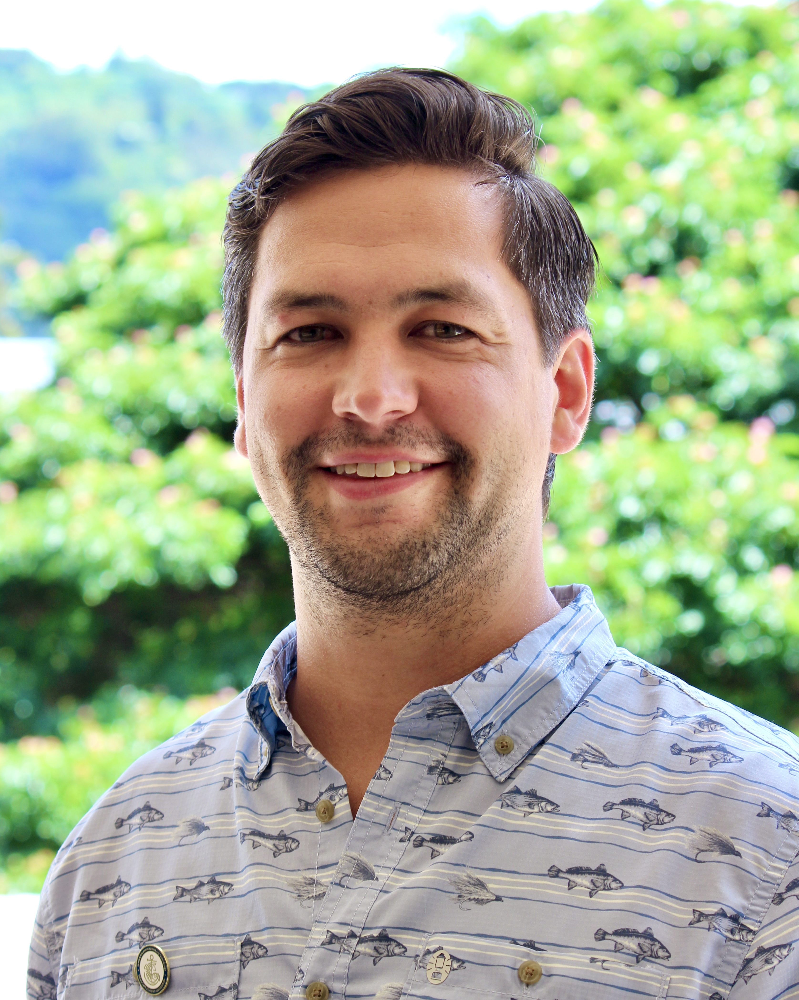

::: {.hero}
{fig-alt="Headshot of Max Grezlik"}

::: {.hero-text}
## Hi, I’m Max Grezlik

Fishery Data Analyst · NOAA Northeast Fisheries Science Center
:::
:::

I'm a fisheries scientist with a passion for data-driven solutions in marine conservation and resource management. My work bridges the gap between ecological research and applied fisheries science, with a strong focus on quantitative methods, ecosystem based fisheries management, and sustainable fisheries.

I regularly use **R**, **RStudio**, and **GitHub** to build tools, analyze complex datasets, and communicate findings. This site is a hub for my current projects, publications, and CV.

See what I'm working on now on the [Projects](projects.qmd) page. You can find my code on GitHub in two places: work for NOAA's Northeast Fisheries Science Center is on my work account, [MGrezlik](https://github.com/MGrezlik), and personal projects, including this site, are on [MaxGrezlik](https://github.com/MaxGrezlik).

Whether you're a collaborator, a fellow scientist, or just curious about fisheries research, welcome!
